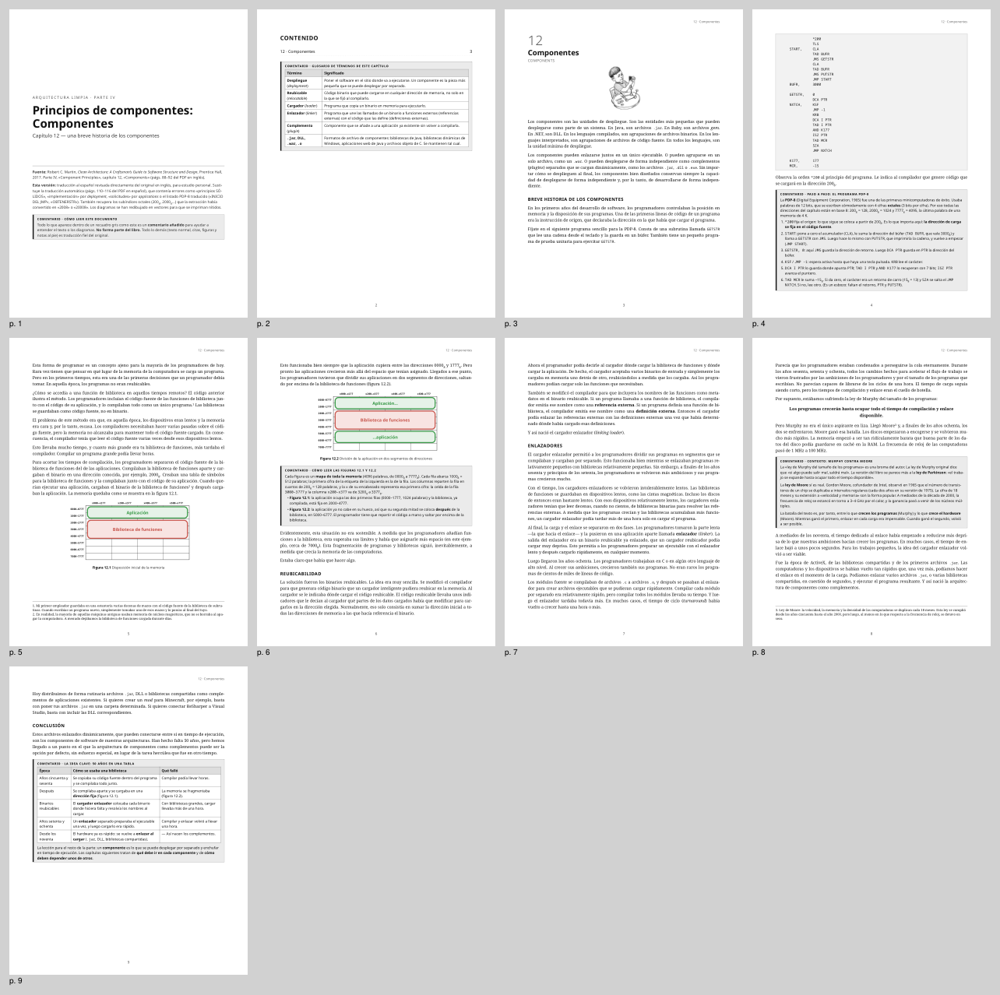
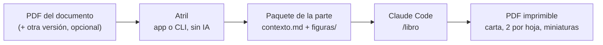
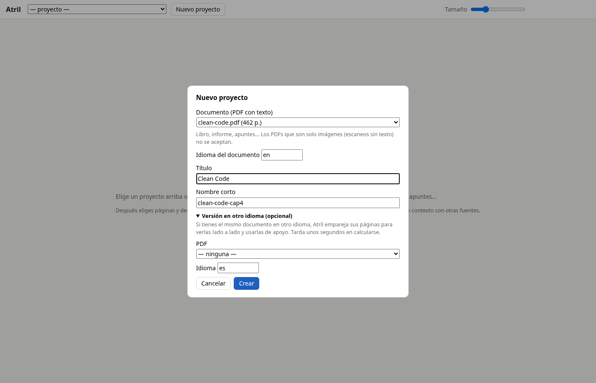
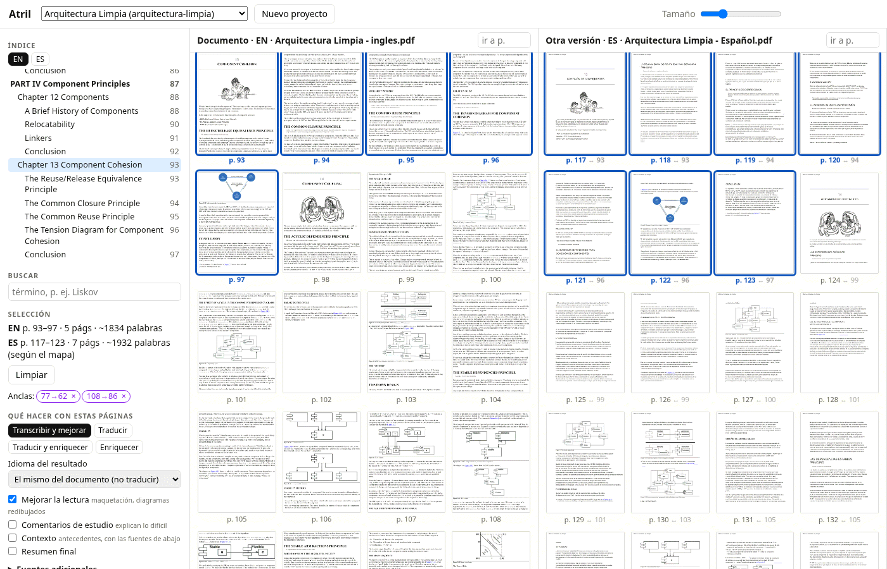
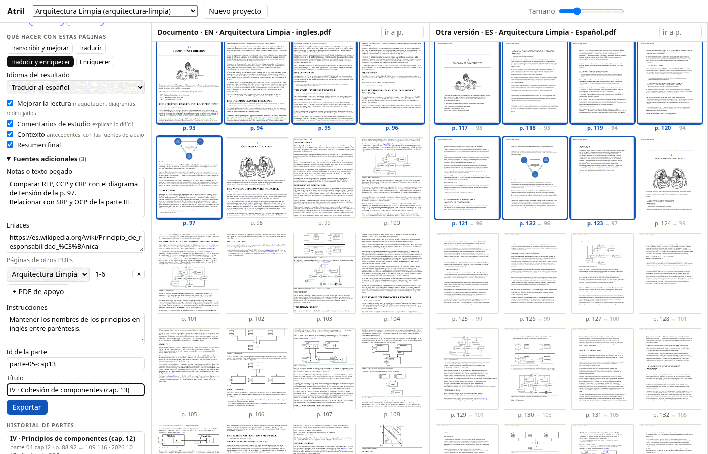
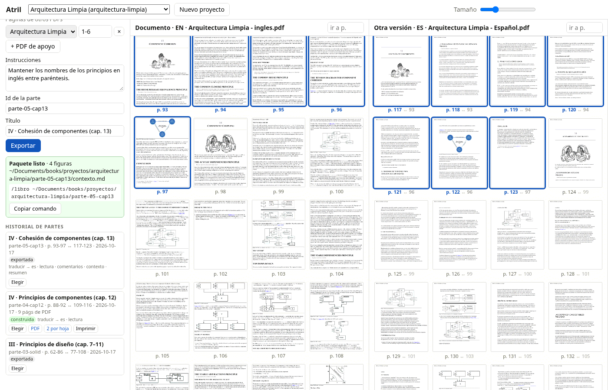
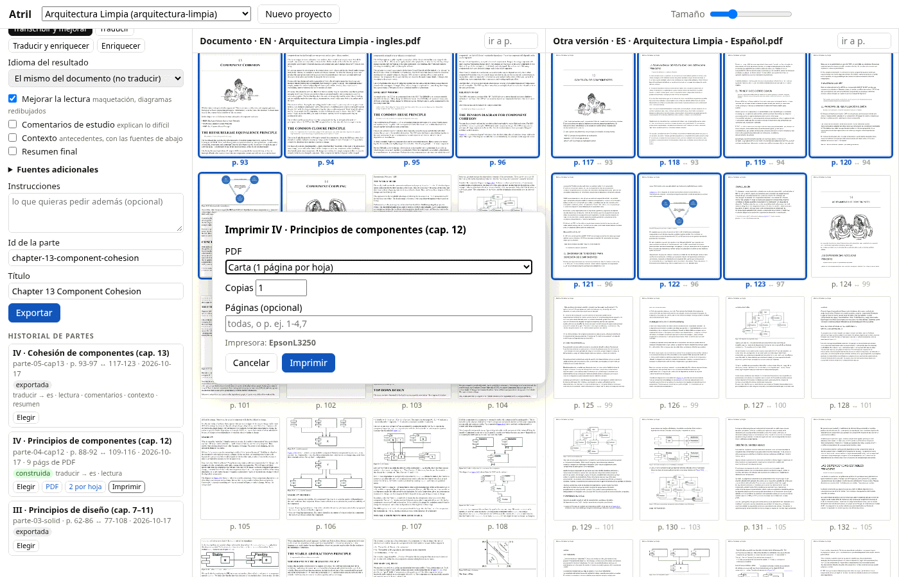

# Atril

Atril prepara documentos para leerlos y estudiarlos mejor, por partes: libros, informes,
apuntes. Eliges un rango de páginas de un PDF con texto, decides qué hacer con ellas
(transcribir con una maquetación limpia, traducir, agregar comentarios de estudio o contexto)
y al final obtienes un PDF listo para imprimir.



Atril no usa ninguna API de pago. Todo lo mecánico (leer el PDF, limpiar el texto, emparejar
páginas, armar el paquete, generar el PDF) lo hace código determinista. La parte que necesita
IA ocurre dentro de [Claude Code](https://claude.com/claude-code), con la skill `/libro` y tu
suscripción. Como Claude recibe el texto ya limpio y no las páginas del PDF, se gasta mucho
menos del plan.

## Qué puedes hacer

- **Transcribir y mejorar la lectura**: el texto con una maquetación cuidada y los diagramas
  redibujados en SVG, en blanco, negro y grises. Si no traduces, la transcripción es fiel: solo
  se corrige lo que rompió la extracción del PDF.
- **Traducir** a otro idioma, con un glosario que se acumula de una parte a otra. Por defecto
  el resultado queda en el idioma del documento.
- **Estudiar**: recuadros de comentario que explican lo difícil, recuadros de contexto
  apoyados en fuentes adicionales (notas pegadas, enlaces y páginas de otros PDFs) y un
  resumen final de repaso.
- **Leer lado a lado con otra versión** del mismo documento en otro idioma. Atril empareja
  sus páginas automáticamente y puedes corregir el emparejamiento con anclas manuales.
- **Elegir partes desde el índice** del PDF o, si no trae, desde un índice detectado por el
  tamaño de letra de los títulos. También puedes buscar un término o marcar páginas a mano.
- **Exportar un paquete limpio** (`contexto.md` más las figuras) con el texto ya fusionado y
  la tarea por escrito.
- **Generar el PDF imprimible** en tamaño carta, una versión de 2 páginas por hoja y
  miniaturas para revisar la maqueta.
- **Llevar el historial de partes**: qué páginas, cuándo, en qué estado y con qué tarea, con
  enlaces a sus PDFs.

**Límites:** solo acepta PDFs con capa de texto. Los PDFs que son solo imágenes (escaneos sin
texto) se rechazan y no hay OCR.

## Cómo funciona



1. Atril lee el PDF, quita encabezados, pies y números de página, reconstruye los párrafos y
   extrae las figuras.
2. Al exportar una parte, escribe `contexto.md`: la tarea, tus instrucciones, el glosario, el
   índice de la parte, las fuentes adicionales y el contenido, página por página (con la otra
   versión al lado, si la hay).
3. En Claude Code, `/libro <carpeta>` lee el paquete, te confirma el plan, escribe el HTML
   sección por sección, redibuja los diagramas, construye el PDF y lo revisa con las
   miniaturas.

## Requisitos e instalación

- Python 3.14 o superior.
- [uv](https://docs.astral.sh/uv/).
- Las librerías de sistema que pide [WeasyPrint](https://doc.courtbouillon.org/weasyprint/stable/first_steps.html)
  (sobre todo Pango). En la mayoría de las distribuciones de Linux ya vienen instaladas.
- Claude Code, para la skill `/libro`.

```fish
git clone <este repo> ~/Projects/atril
cd ~/Projects/atril
uv sync
```

Atril busca los PDFs en `~/Documents/books` y guarda los proyectos en
`~/Documents/books/proyectos/<proyecto>/`. Puedes cambiar estas rutas con variables de
entorno:

| Variable | Para qué |
|---|---|
| `ATRIL_LIBROS` | carpeta donde la app busca los PDFs |
| `ATRIL_PROYECTOS` | carpeta de los proyectos |
| `ATRIL_CACHE` | caché de miniaturas (por defecto, `~/.cache/atril/paginas`) |
| `ATRIL_HOST` | dirección donde escucha la app (por defecto, `127.0.0.1`) |

En vez de exportarlas, copia `.env.example` a `.env` (no se sube a git) y edítalo; las
variables del entorno real tienen prioridad sobre el archivo.

## Uso con la app

```fish
uv run atril app          # abre el navegador en http://localhost:8765
```

**1. Crea el proyecto.** Con «Nuevo proyecto» eliges el PDF del documento, su idioma, un
título y un nombre corto. Si tienes el mismo documento en otro idioma, lo agregas en «Versión
en otro idioma»: Atril empareja sus páginas en unos segundos.



**2. Elige las páginas.** Las miniaturas del documento y de la otra versión aparecen lado a
lado, emparejadas por el mapa de páginas. Puedes elegir un capítulo desde el índice, buscar un
término o hacer clic en una página y mayús+clic en otra para marcar el rango. Si el
emparejamiento está corrido, ajusta la selección de la otra versión y guárdala con «Guardar
ajuste como ancla». Doble clic abre una página en grande.



**3. Decide qué hacer.** En «Qué hacer con estas páginas» hay atajos (transcribir y mejorar,
traducir, traducir y enriquecer, enriquecer), el idioma del resultado y las opciones: mejorar
la lectura, comentarios de estudio, contexto y resumen final. En «Fuentes adicionales» sumas
notas, enlaces y páginas de otros PDFs. Pon un id para la parte, un título y, si quieres,
instrucciones propias.



**4. Exporta.** La app escribe el paquete y te muestra el comando `/libro …` listo para
copiar. Pégalo en Claude Code abierto en este repositorio.



**5. Revisa y descarga.** En «Historial de partes» ves cada parte con su tarea, páginas, fecha y
estado, los enlaces a los PDFs construidos (carta y 2 por hoja), «Elegir» para volver a
seleccionar esas páginas.



## Uso por línea de comandos

Todo lo anterior se puede hacer también desde la terminal:

```fish
# 1. Crear el proyecto: el documento y, opcional, otra versión en otro idioma (calcula el mapa)
uv run atril nuevo arquitectura-limpia --titulo "Arquitectura Limpia" \
    --original "~/Documents/books/Arquitectura Limpia - ingles.pdf" \
    --referencia "~/Documents/books/Arquitectura Limpia - Español.pdf"

# 2. Ubicar la parte: índice del original y consulta o corrección del mapa
uv run atril indice arquitectura-limpia
uv run atril mapa arquitectura-limpia --referencia 77-108      # → páginas del original
uv run atril mapa arquitectura-limpia --ancla 77=62            # corregir a mano

# 3. Exportar la parte con su tarea (por defecto: mismo idioma, mejorar la lectura)
uv run atril exportar arquitectura-limpia parte-03-solid --original 62-86 \
    --traducir es --comentarios --contexto \
    --notas apuntes.md --enlace https://es.wikipedia.org/wiki/SOLID --pdf "otro.pdf:3-8" \
    --titulo-parte "III · Principios de diseño"
```

Otras opciones de `exportar`: `--resumen` (resumen final), `--sin-mejorar` (solo el texto,
con las figuras originales) e `--instrucciones` (un archivo, o `-` para leer de la entrada
estándar).

Después, en Claude Code abierto en este repositorio: `/libro <carpeta de la parte>`. La skill
hace lo que diga la tarea y, para la salida, usa estos comandos, que también puedes correr a
mano:

```fish
uv run atril iniciar   ~/Documents/books/proyectos/arquitectura-limpia/parte-03-solid  # HTML desde la plantilla
uv run atril construir ~/Documents/books/proyectos/arquitectura-limpia/parte-03-solid  # PDF, 2 por hoja, miniaturas
uv run atril ver       ~/Documents/books/proyectos/arquitectura-limpia/parte-03-solid 5,7-8
```

Otros comandos:

```fish
uv run atril proyectos                                      # listar proyectos
uv run atril indice arquitectura-limpia --referencia        # índice detectado si el PDF no trae
```

`uv run atril <comando> --help` muestra todas las opciones de cada comando.

## Qué queda en cada proyecto

```
~/Documents/books/proyectos/arquitectura-limpia/
  libro.json          rutas de los PDFs, idiomas, mapa de páginas, anclas y partes
  glosario.md         términos decididos; se copia en cada exportación nueva
  parte-03-solid/
    contexto.md       el paquete que lee /libro
    figuras/          figuras en su formato original (fig-7.1.jpeg, ilus-p064-1.jpeg…)
    salida/           HTML, SVG, PDF, PDF 2 por hoja y revision/ con las miniaturas
```

## Estructura del repositorio

- `src/atril/`
  - núcleo: `pdf` (lee el PDF y clasifica el texto), `cleaning` (quita marcas, encabezados y
    pies; reconstruye párrafos), `mapping` (empareja las páginas de las dos versiones),
    `bundle` (escribe el paquete), `project` (carpeta y `libro.json` de cada proyecto) y `cli`;
  - salida: `build` (HTML → PDF, 2 por hoja y miniaturas), `svg` (librería de diagramas) y
    `template/` (`base.html` y `libro.css`);
  - app: `app` (FastAPI), `thumbnails` (miniaturas de página con caché) y `web/` (HTML + JS
    sin paso de build);
- `.claude/skills/libro/`: la skill `/libro`.
- `referencia/solid/`: la Parte III de *Arquitectura Limpia* (principios SOLID) hecha a mano.
  Es el modelo de estilo de la skill y la prueba de regresión de la plantilla.
- `tests/`: pruebas con PDFs sintéticos, con el caso SOLID y con la Parte III del libro real
  (estas últimas se saltan si los PDFs no están en `~/Documents/books`).
- `PLAN.md`: las fases del proyecto y su estado.

```fish
uv run pytest
```
